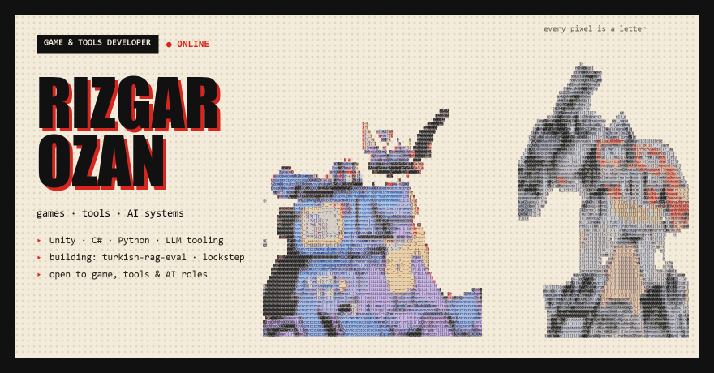

## Boss fight: Autobots vs Megatron

Everyone who visits plays the same fight. Click a move and it's played on the spot: Megatron answers, the scene below is redrawn, and you land back here. If the picture looks unchanged, give it a few seconds and refresh.

<!-- boss:start -->
**GRIMLOCK's turn** · round 3 · Megatron 5528/6200. Pick a move ↓

| Move | Cost | Effect |
|---|---|---|
| [**ATTACK**](https://autobots-boss.rizgarozan7.workers.dev/move?h=grimlock&m=atk&k=9) | – | ENERGO SWORD: hit for 220–290 |
| [**ME GRIMLOCK KING**](https://autobots-boss.rizgarozan7.workers.dev/move?h=grimlock&m=skill1&k=9) | 6 EP | Taunt: single-target hits go to Grimlock |
| [**FIRE BREATH**](https://autobots-boss.rizgarozan7.workers.dev/move?h=grimlock&m=skill2&k=9) | 16 EP | Hit for 400–480 |
| [**GUARD**](https://autobots-boss.rizgarozan7.workers.dev/move?h=grimlock&m=guard&k=9) | – | Take ½ damage this round, +8 EP |
| LIMIT: GRIMLOCK SMASH | 39% | Locked, fills as you attack and take hits |

Move links not opening on your network? [Play it as an issue](https://github.com/RizgarOzan/autobots-vs-megatron/issues/new?title=boss%3A%20grimlock%20atk&body=Change%20atk%20to%20skill1%2C%20skill2%2C%20guard%20or%20limit%20for%20another%20move%2C%20then%20press%20Submit.%20A%20GitHub%20Action%20plays%20it%20and%20updates%20the%20README%20in%20about%20a%20minute.) instead.

**Last moves**
- Bumblebee scouts ahead: next up is FUSION CANNON. The party braces.
- Megatron uses FULL POWER BLAST on everyone. 517 damage.
- HOT ROD uses PHOTON SHOT. 218 damage.

earlier

- @RizgarOzan · GRIMLOCK: GRIMLOCK braces and recovers 8 EP.
- @RizgarOzan · BUMBLEBEE: BUMBLEBEE braces and recovers 8 EP.
- Megatron charges his fusion cannon. Something big is coming. Guard!
- @RizgarOzan · HOT ROD: HOT ROD braces and recovers 8 EP.
- @RizgarOzan · GRIMLOCK: GRIMLOCK uses ENERGO SWORD. 283 damage.

**Top damage this fight**: 🥇 @RizgarOzan 454 · 🥈 one-click visitors (2 moves) 218
<!-- boss:end -->

Each round the heroes go in order (Bumblebee, Grimlock, Hot Rod), then Megatron answers. Below half HP Soundwave joins him. When he charges his cannon, GUARD halves the blast. If someone moved before you, the page tells you and you pick again from the fresh board.
