## Duel: Soundwave vs Shockwave

Everyone who visits plays Soundwave in the same duel. Pick a move: Shockwave's AI answers and the scene below is redrawn. If the picture looks unchanged, give it a few seconds and refresh.

<!-- boss:start -->
**Round 4** · Soundwave 2392/3000 HP, 16 EP · Shockwave 3163/3750. Pick Soundwave's move ↓

> 🧠 **Mind scan:** Shockwave plans **POWER DIVERT** next. His logic: "Probability favours a decisive strike."

| Move | Cost | Effect |
|---|---|---|
| [**ATTACK**](https://autobots-boss.rizgarozan7.workers.dev/move?h=soundwave&m=atk&k=6) | – | SONIC BLASTER: hit for 200–260 |
| [**LASERBEAK**](https://autobots-boss.rizgarozan7.workers.dev/move?h=soundwave&m=skill1&k=6) | 14 EP | Hit twice for 110–140 each |
| [**MIND SCAN**](https://autobots-boss.rizgarozan7.workers.dev/move?h=soundwave&m=skill2&k=6) | 8 EP | Hit for 90–120, take half damage this round (even from CRUSHING GRIP), and see Shockwave's plan and reasoning for next round |
| [**GUARD**](https://autobots-boss.rizgarozan7.workers.dev/move?h=soundwave&m=guard&k=6) | – | Take a third of the damage this round, +10 EP, +15% limit. CRUSHING GRIP goes through it |
| LIMIT: CASSETTE ASSAULT | 66% | Locked, fills as you attack, guard and take hits |

Move links not opening on your network? [Play it as an issue](https://github.com/RizgarOzan/autobots-vs-megatron/issues/new?title=boss%3A%20soundwave%20atk&body=Change%20atk%20to%20skill1%2C%20skill2%2C%20guard%20or%20limit%20for%20another%20move%2C%20then%20press%20Submit.%20A%20GitHub%20Action%20plays%20it%20and%20updates%20the%20README%20in%20about%20a%20minute.) instead.

**Last moves**
- Shockwave uses JAMMING PULSE. 96 damage, and 14 EP drained.
- @RizgarOzan · Soundwave probes Shockwave's mind for 119 damage: JAMMING PULSE is coming, and his next plan will show. Incoming damage halved this round.
- Shockwave uses ARM CANNON. 280 damage.

earlier

- Soundwave uses SONIC BLASTER. 219 damage.
- Shockwave uses ARM CANNON. 232 damage.
- @RizgarOzan · Laserbeak makes two passes: 120 and 129.
- Soundwave and Shockwave face off.

**Top damage this duel**: 🥇 @RizgarOzan 368 · 🥈 one-click visitors (1 move) 219
<!-- boss:end -->

Each round Soundwave moves, then Shockwave answers. Shockwave doesn't pick at random: he plans his next move from what you just did. Guard twice in a row and he crushes the guard, sit on full EP and he jams it, fall low and he goes for the finish, get him low and he repairs. MIND SCAN shows his next move and his reasoning. When he charges the LOGIC CANNON, GUARD or MIND SCAN. If someone moved before you, the page tells you and you pick again from the fresh board.
