## Duel: Soundwave vs Shockwave

Everyone who visits plays Soundwave in the same duel. Pick a move: Shockwave's AI answers and the scene below is redrawn. If the picture looks unchanged, give it a few seconds and refresh.

<!-- boss:start -->
**Round 3** · Soundwave 2488/3000 HP, 34 EP · Shockwave 3282/3750. Pick Soundwave's move ↓

| Move | Cost | Effect |
|---|---|---|
| [**ATTACK**](https://github.com/RizgarOzan/autobots-vs-megatron/issues/new?title=boss%3A%20soundwave%20atk&body=Just%20press%20Submit.%20A%20GitHub%20Action%20plays%20the%20move%20and%20updates%20the%20README%20in%20about%20a%20minute.) | – | SONIC BLASTER: hit for 200–260 |
| [**LASERBEAK**](https://github.com/RizgarOzan/autobots-vs-megatron/issues/new?title=boss%3A%20soundwave%20skill1&body=Just%20press%20Submit.%20A%20GitHub%20Action%20plays%20the%20move%20and%20updates%20the%20README%20in%20about%20a%20minute.) | 14 EP | Hit twice for 110–140 each |
| [**MIND SCAN**](https://github.com/RizgarOzan/autobots-vs-megatron/issues/new?title=boss%3A%20soundwave%20skill2&body=Just%20press%20Submit.%20A%20GitHub%20Action%20plays%20the%20move%20and%20updates%20the%20README%20in%20about%20a%20minute.) | 8 EP | Hit for 90–120, take half damage this round (even from CRUSHING GRIP), and see Shockwave's plan and reasoning for next round |
| [**GUARD**](https://github.com/RizgarOzan/autobots-vs-megatron/issues/new?title=boss%3A%20soundwave%20guard&body=Just%20press%20Submit.%20A%20GitHub%20Action%20plays%20the%20move%20and%20updates%20the%20README%20in%20about%20a%20minute.) | – | Take a third of the damage this round, +10 EP, +15% limit. CRUSHING GRIP goes through it |
| LIMIT: CASSETTE ASSAULT | 53% | Locked, fills as you attack, guard and take hits |

Each move opens a prefilled issue: press **Submit** and a GitHub Action plays it, usually within a minute.

**Last moves**
- Shockwave uses ARM CANNON. 280 damage.
- Soundwave uses SONIC BLASTER. 219 damage.
- Shockwave uses ARM CANNON. 232 damage.

earlier

- @RizgarOzan · Laserbeak makes two passes: 120 and 129.
- Soundwave and Shockwave face off.

**Top damage this duel**: 🥇 @RizgarOzan 249 · 🥈 one-click visitors (1 move) 219
<!-- boss:end -->

Each round Soundwave moves, then Shockwave answers. Shockwave doesn't pick at random: he plans his next move from what you just did. Guard twice in a row and he crushes the guard, sit on full EP and he jams it, fall low and he goes for the finish, get him low and he repairs. MIND SCAN shows his next move and his reasoning. When he charges the LOGIC CANNON, GUARD or MIND SCAN. If someone moved before you, the page tells you and you pick again from the fresh board.
